<h3><code>Haamzzaa@github ~ $ whoami</code></h3>

<table>
<tr>
<td valign="middle" align="center"></td>
<td valign="middle" align="center"></td>
</tr>
</table>

<code>SOFTWARE DEVELOPER · PYTHON · BACKEND · SALESFORCE</code>

<code>GOTHAM SYSTEM // ONLINE</code>

 

<h3><code>Haamzzaa@github ~ $ ./contributions.sh</code></h3>

